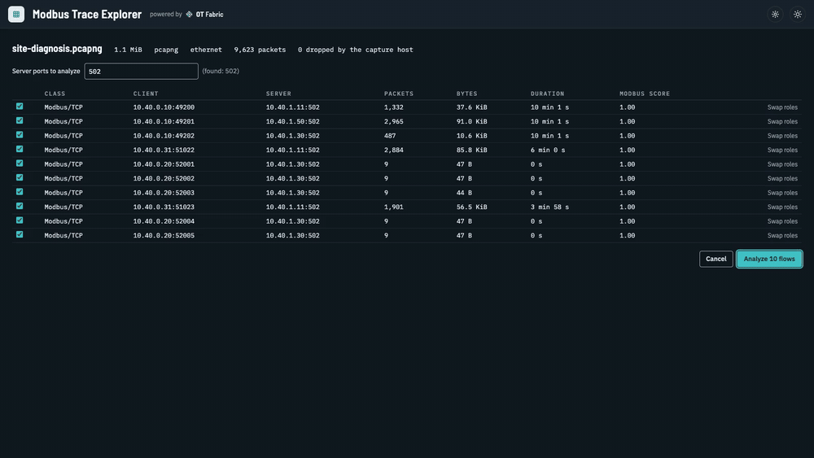
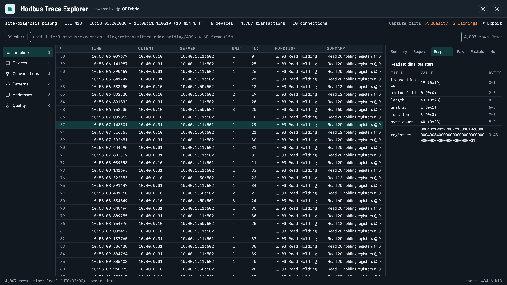
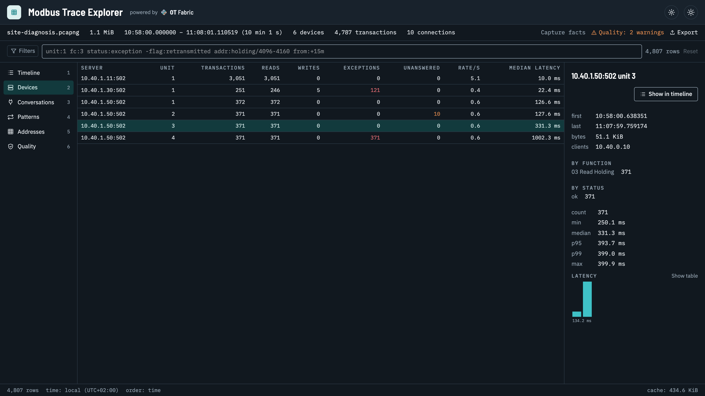
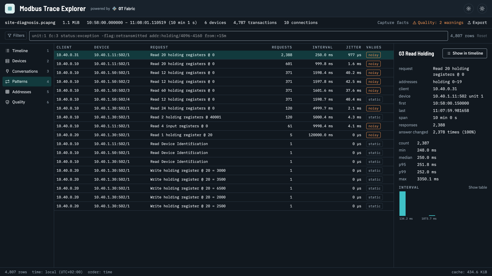
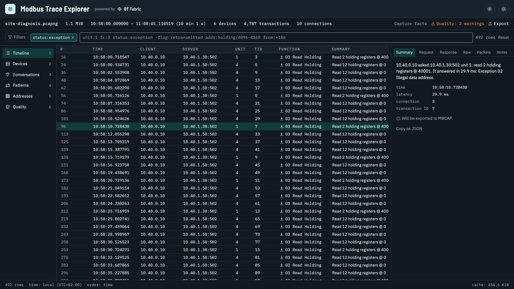
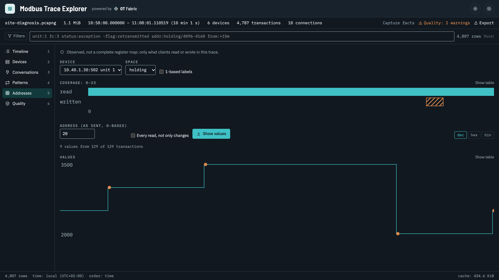
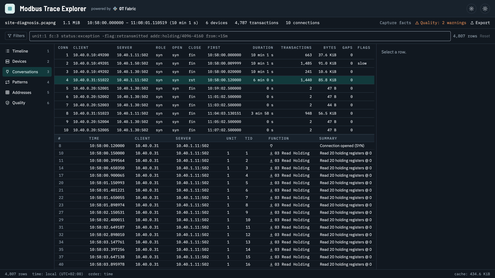
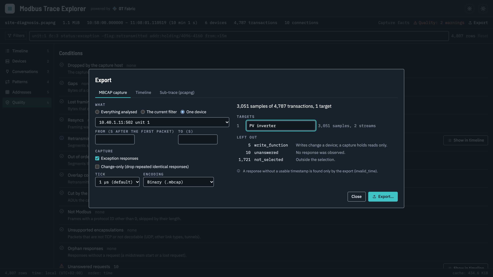
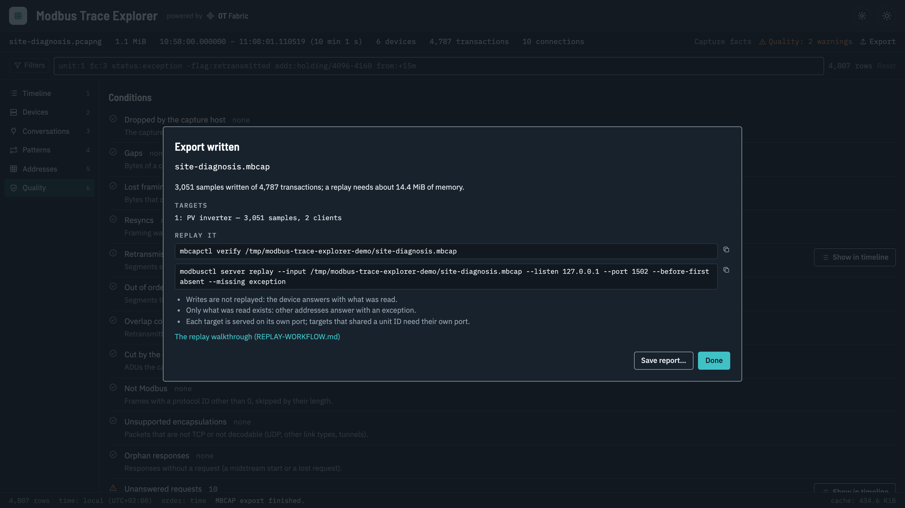

# OT Fabric Modbus Trace Explorer

[](LICENSE)
[](https://github.com/otfabric/modbus-trace-explorer/actions/workflows/ci.yml)
[](https://codecov.io/gh/otfabric/modbus-trace-explorer)
[](https://github.com/otfabric/modbus-trace-explorer/releases)

**Open a packet trace of Modbus/TCP traffic and see it in Modbus terms: every request with its response, per device, per poll and per register, then export the real traffic to replay as a simulated device.**

Built by OT Fabric on [go-modbus-trace](https://github.com/otfabric/go-modbus-trace). MIT licensed. Reads pcap and pcapng from tcpdump, Wireshark, dumpcap or tshark, and MBCAP captures. It never talks to devices, never writes to Modbus and does not capture live. The current release is on the [releases page](https://github.com/otfabric/modbus-trace-explorer/releases/latest).



*The demo above, in full quality: [`docs/media/demo.mp4`](docs/media/demo.mp4) (two minutes, on the synthetic trace [`testdata/corpus/realistic/site-diagnosis.pcapng`](testdata/corpus/realistic/site-diagnosis.pcapng)).*

## What it is for

### 1. Find what goes wrong between a Modbus client and its devices

Data arrives late, values are missing, a gateway is overloaded, a register reads garbage. A packet tool shows each packet in turn; the question is about devices, polls and registers. Here a trace becomes:

- **Latency per device and unit**, with quantiles and a histogram: which device, or which unit behind a gateway, holds up the cycle.
- **Poll plans per client**: what each client reads, how often and how regularly (interval, jitter), how often the answer changes. Duplicate polling, polls faster than the data changes, and cycles that stretch past their interval show up at once.
- **Exceptions, no responses and gateway errors**, filterable (`status:exception`, `unit:4`, `addr:holding/4096-4160`) and explained in words.
- **Wrong registers**: what was actually read and written per device, and the values of one register over time with the writes marked.
- **Connections**: which side is the server, when connections open, reset and come back, gaps and retransmissions, and what the capture itself missed.

### 2. Real data for a simulator or digital twin

Recorded traffic beats invented test data. Export what devices really answered, for everything, the current filter or one device, as an **MBCAP capture**; the preview says what goes in and why the rest stays out before anything is written. [`modbusctl server replay`](https://github.com/otfabric/modbusctl) then serves those answers as a simulated device, for testing a client, a dashboard or an integration without the real installation. The Explorer opens MBCAP files too, to see what a replay will serve.

The timeline also exports as CSV or JSON Lines, and a filtered sub-trace as pcapng.

| | |
|---|---|
|  |  |
| **The timeline**: one row per transaction, request and response together, with function, registers, result and latency; the detail decodes both PDUs field by field, down to the bytes and the packets. | **Devices**: transactions, exceptions, no responses and latency quantiles per server and unit. Here, meters behind an RTU gateway answer in 90 to 400 ms and one is offline. |
|  |  |
| **Patterns**: each client's polls with interval and jitter. An EMS reads the inverter every 250 ms on top of the SCADA's 1 s poll; the meter cycle meant for 1 s takes 1.6 s. | **Filters** in a short grammar or with controls. `status:exception` shows a SCADA reading 40001, a 4x address on a 0-based map: illegal data address. |
|  |  |
| **Addresses**: what was read and written per device, and one register's values over time with the writes marked. Observed traffic, not a register map. | **Conversations**: every connection with its role, duration, how it ended, gaps and flags, and its own timeline. |
|  |  |
| **Export** one device as MBCAP, labelled; the preview counts the samples and every exclusion with its reason. | **Replay it**: the dialog gives the `mbcapctl verify` and `modbusctl server replay` commands and their caveats. |

Also: the [Flows step](docs/images/flows.png) that proposes the Modbus flows of a trace; the [Quality view](docs/images/quality.png) with every condition the library counted; large traces (the timeline appears while the analysis runs; a million rows page, filter and sort in milliseconds); ring-buffer files opened together and gzip traces as they are; a [light theme](docs/images/light.png) and full keyboard navigation.

The trace understanding is the library [go-modbus-trace](https://github.com/otfabric/go-modbus-trace), whose CLI `mbtracectl` does the same headless, on a gateway or in CI.

## Install

Every release has the files below, a checksum file (`modbus-trace-explorer-<version>-checksums.txt`) and build provenance. The files are **not code-signed yet**, so macOS and Windows warn on the first start; the steps for that are under each platform.

| Platform | File |
|---|---|
| macOS 13 or later, Apple silicon | `modbus-trace-explorer-<version>-darwin-arm64.zip` |
| macOS 13 or later, Intel | `modbus-trace-explorer-<version>-darwin-amd64.zip` |
| Windows 10 or 11, x64 | `modbus-trace-explorer-<version>-windows-amd64.zip` |
| Windows 11 on ARM | `modbus-trace-explorer-<version>-windows-arm64.zip` (best effort) or the x64 build |
| Linux, x86-64 / arm64 (GTK 4, WebKitGTK 6.0) | `modbus-trace-explorer-<version>-linux-amd64.tar.gz` / `-linux-arm64.tar.gz` |

All downloads are on the [releases page](https://github.com/otfabric/modbus-trace-explorer/releases/latest). The commands below fetch the latest release and check its checksum. You can also check the build provenance: `gh attestation verify <file> --repo otfabric/modbus-trace-explorer`.

### macOS

```sh
VERSION=$(curl -fsSL https://api.github.com/repos/otfabric/modbus-trace-explorer/releases/latest | sed -n 's/.*"tag_name": *"v\([^"]*\)".*/\1/p')
ARCH=$(uname -m | sed 's/x86_64/amd64/')            # arm64 or amd64
FILE="modbus-trace-explorer-${VERSION}-darwin-${ARCH}.zip"
BASE="https://github.com/otfabric/modbus-trace-explorer/releases/download/v${VERSION}"
curl -fsSLO "${BASE}/${FILE}" && curl -fsSLO "${BASE}/modbus-trace-explorer-${VERSION}-checksums.txt"
grep " ${FILE}\$" "modbus-trace-explorer-${VERSION}-checksums.txt" | shasum -a 256 -c -
ditto -x -k "${FILE}" /Applications
open "/Applications/Modbus Trace Explorer.app"
```

The app is ad-hoc signed, not notarized. If macOS refuses to open it, go to System Settings → Privacy & Security and choose "Open Anyway" once, or remove the quarantine flag: `xattr -dr com.apple.quarantine "/Applications/Modbus Trace Explorer.app"` (a file downloaded with `curl` usually has none). Traces open by dropping them on the window, with File → Open, or with "Open With" in the Finder.

### Windows

In PowerShell:

```powershell
$version = (Invoke-RestMethod https://api.github.com/repos/otfabric/modbus-trace-explorer/releases/latest).tag_name.TrimStart('v')
$file    = "modbus-trace-explorer-$version-windows-amd64.zip"
$base    = "https://github.com/otfabric/modbus-trace-explorer/releases/download/v$version"
Invoke-WebRequest "$base/$file" -OutFile $file
Invoke-WebRequest "$base/modbus-trace-explorer-$version-checksums.txt" -OutFile checksums.txt
$expected = ((Select-String -Path checksums.txt -Pattern " $file$").Line -split '\s+')[0]
if ((Get-FileHash $file -Algorithm SHA256).Hash -ne $expected.ToUpper()) { throw "checksum mismatch" }
Expand-Archive $file -DestinationPath "$env:LOCALAPPDATA\Programs\Modbus Trace Explorer" -Force
& "$env:LOCALAPPDATA\Programs\Modbus Trace Explorer\modbus-trace-explorer-$version-windows-amd64\modbus-trace-explorer.exe"
```

SmartScreen shows "Windows protected your PC" the first time: choose "More info", then "Run anyway". Windows 10 needs the [WebView2 runtime](https://developer.microsoft.com/microsoft-edge/webview2/); Windows 11 has it.

### Linux

The application needs GTK 4 and WebKitGTK 6.0: Debian 13, Ubuntu 24.04 or later.

```sh
sudo apt install libgtk-4-1 libwebkitgtk-6.0-4
VERSION=$(curl -fsSL https://api.github.com/repos/otfabric/modbus-trace-explorer/releases/latest | sed -n 's/.*"tag_name": *"v\([^"]*\)".*/\1/p')
ARCH=$(dpkg --print-architecture)                    # amd64 or arm64
FILE="modbus-trace-explorer-${VERSION}-linux-${ARCH}.tar.gz"
BASE="https://github.com/otfabric/modbus-trace-explorer/releases/download/v${VERSION}"
curl -fsSLO "${BASE}/${FILE}" && curl -fsSLO "${BASE}/modbus-trace-explorer-${VERSION}-checksums.txt"
grep " ${FILE}\$" "modbus-trace-explorer-${VERSION}-checksums.txt" | sha256sum -c -
tar xzf "${FILE}" && sudo install -m 0755 "${FILE%.tar.gz}/modbus-trace-explorer" /usr/local/bin/
modbus-trace-explorer site.pcapng
```

## Capturing a trace

The Explorer reads traces; it does not capture them. Any tool that writes pcap or pcapng will do. What makes a trace useful:

- **Where.** Capture where both directions of the Modbus traffic pass: on the client (SCADA host, gateway, PLC programming PC), on a switch port that mirrors the device's port (SPAN), or with a network tap. A capture on an ordinary switch port sees only that port's own traffic.
- **Whole packets.** Do not cut packets short (`-s 0`, the default in current tools). A cut ADU cannot be decoded and is reported as "cut by the snap length".
- **From before the connections open.** Start capturing, then start (or restart) the poller. The connection's handshake shows which side is the server; without it the Explorer infers it from the traffic and says so ("guessed roles").
- **Keep the TCP packets.** Filter by port when capturing, not by protocol afterwards: saving only the packets Wireshark decodes as `modbus` drops the handshakes, retransmissions and acknowledgements the reassembly needs.
- **Modbus/TCP Security** (TLS, usually port 802) is encrypted and cannot be decoded; the Flows step names it.

The examples capture port 502. For devices on other ports, extend the filter (`tcp port 502 or tcp port 1502`) and enter the port in the Flows step. Capturing needs privileges: `sudo` (or membership of the `wireshark` group on Linux), the ChmodBPF helper that Wireshark installs on macOS, Npcap on Windows. Interface names differ per system: `tcpdump -D`, `dumpcap -D` or `tshark -D` list them.

### tcpdump (Linux, macOS)

```sh
# Until Ctrl+C; full packets, no name lookups.
sudo tcpdump -i eth0 -s 0 -n -w site.pcap 'tcp port 502'

# A long capture in files of 100 MB, keeping the last 50 (5 GB at most).
sudo tcpdump -i eth0 -s 0 -n -C 100 -W 50 -w site.pcap 'tcp port 502'

# One file per hour, named by its start time.
sudo tcpdump -i eth0 -s 0 -n -G 3600 -w 'site-%Y%m%d-%H%M.pcap' 'tcp port 502'

# On a remote gateway, written on your machine.
ssh admin@gateway "sudo tcpdump -i eth0 -s 0 -n -U -w - 'tcp port 502'" > site.pcap
```

When tcpdump stops it prints how many packets the kernel dropped; more than zero means reads may be missing from the trace.

### dumpcap (comes with Wireshark; Linux, macOS, Windows)

dumpcap is Wireshark's capture engine: no decoding, so it keeps up on long captures, and its pcapng records the drops (the Explorer shows them in the Quality view).

```sh
dumpcap -D                                            # list the interfaces
dumpcap -i eth0 -f "tcp port 502" -w site.pcapng

# A day in files of 100 MB (100000 kB), the last 50 kept; stops after 24 hours.
dumpcap -i eth0 -f "tcp port 502" -b filesize:100000 -b files:50 -a duration:86400 -w site.pcapng
```

On Windows the interface is a number from `dumpcap -D` or its full name:

```powershell
& "C:\Program Files\Wireshark\dumpcap.exe" -D
& "C:\Program Files\Wireshark\dumpcap.exe" -i 3 -f "tcp port 502" -w "$env:USERPROFILE\Desktop\site.pcapng"
```

### tshark (comes with Wireshark)

```sh
# One hour, then stop. -f is a capture filter; do not use a display filter (-Y) when writing a file.
tshark -i eth0 -f "tcp port 502" -a duration:3600 -w site.pcapng
```

### Wireshark

1. Capture → Options: pick the interface and type `tcp port 502` as the capture filter (the field on the Input tab, not the display filter bar).
2. For a long capture, Output tab: a file name, pcapng, and "Create a new file automatically" every 100 MB with a ring buffer.
3. Start, let the poller run, stop.
4. File → Save As, pcapng, with all packets ("Export Specified Packets" with a `modbus` display filter would leave out the TCP packets the Explorer needs).

### Opening what you captured

Open the file, or select all the files of a ring buffer together: they are read as one trace, in the order of their first packets. Compressed files (`site.pcapng.gz`) open as they are. The Quality view then says what the capture missed: drops, cut packets, gaps, guessed roles.

## Sample files

`testdata/corpus` has synthetic traces and captures to try the Explorer with, no capture of your own needed: `realistic/site-diagnosis.pcapng` (the demo's site with its problems, 10 minutes), `realistic/plant-scada.pcapng` (a small plant, 15 minutes), its ring-buffer parts, its MBCAP exports, `realistic/rtu-gateway.pcap` and `realistic/function-tour.pcapng`, plus hard and broken files; its README describes each one.

## A short tour

1. **Open** a trace: drop it on the window, File → Open (`Ctrl/Cmd+O`), Open Recent, or `modbus-trace-explorer site.pcapng.gz`. Several files are one trace in the order of their first packets; gzip is decompressed into the cache while the trace is open.
2. **Flows**: the scan lists the TCP flows; the Modbus ones are ticked and their server ports filled in. A device on another port: type the port and scan again. TLS (Modbus/TCP Security) is named and cannot be decoded. Analyse.
3. **Timeline**: one row per transaction (request and response together), connection events, gaps and resyncs. Filter with the controls (Filters) or the text box, for example:

   ```text
   unit:1 fc:3,4 status:exception
   server:10.0.3.21:502 addr:holding/4096-4160 from:14:30 to:+15m
   class:write -flag:retransmitted
   ```

   `Ctrl/Cmd+G` goes to a time, `Ctrl/Cmd+Shift+G` to a Wireshark frame number, `N`/`P` to the next or previous row of the same connection. The detail pane (`Enter`) shows the request and response in words and by field, the bytes (select and copy them as hex or as a C or Python byte string) and the packets with their Wireshark filter.
4. **Views** (`1`–`6`): Devices (latency quantiles), Conversations, Patterns (poll plans: interval, jitter, how often the answer changes), Addresses (what was read and written, and the values of one address over time), Quality (every condition the library counted, with what it means).
5. **Export** (`Ctrl/Cmd+E`): an MBCAP capture with a live preview of what goes in and why the rest stays out; the timeline as CSV or JSON Lines; a pcapng sub-trace. After an MBCAP export the dialog gives the commands to check and replay it:

   ```sh
   mbcapctl verify site.mbcap
   modbusctl server replay --input site.mbcap --listen 127.0.0.1 --port 1502 --before-first absent --missing exception
   ```

An **MBCAP capture** (`.mbcap`, `.mbcap.jsonl`, `.mbcap.csv`, for example one exported here) opens the same way, by itself and read-only: its samples fill the timeline and the views, so you can see what a replay will serve.

Settings (`Ctrl/Cmd+,`) hold the time display, extra server ports for the Flows step, 1-based address labels and the analysis cache (location, size limit, "Clear cache"). Help → About has "Copy diagnostics" for a bug report: versions and the trace's facts, never paths or addresses.

## Development

Start with [AGENTS.md](AGENTS.md), then [docs/REQUIREMENTS.md](docs/REQUIREMENTS.md), [docs/ARCHITECTURE.md](docs/ARCHITECTURE.md), [docs/UX.md](docs/UX.md), [docs/BRANDING.md](docs/BRANDING.md) and [docs/PROPOSAL-REVIEW.md](docs/PROPOSAL-REVIEW.md). `modbus-capture-claude-proposal.md` is the superseded original proposal. Releases are described in [RELEASE.md](RELEASE.md).

```sh
make frontend-install    # once: npm ci
make check               # Go and frontend checks
make build-gui           # ./bin/modbus-trace-explorer (cgo; the platform's webview)
make bundle-macos        # macOS: bin/Modbus Trace Explorer.app with its icon, ad-hoc signed;
                         #   then: open "bin/Modbus Trace Explorer.app"
make smoke               # start it on testdata/smoke.pcapng and wait for the timeline (A15)
make golden              # rewrite the schemas, the engine fixture and the smoke trace
make frontend-coverage   # the frontend tests with coverage (frontend/coverage/lcov.info)
make smoke-corpus        # the built application on every file of testdata/corpus
make fuzz                # fuzz the engine with mutated corpus files (FUZZTIME=5m)
cd frontend && npm run dev   # the user interface over the mock engine, in a browser (?rows=10000000, ?empty)
make spike               # the M0 index measurements (SPIKE_ROWS, default 10,000,000)
make demo-server         # the application served to a browser on localhost:18780, on the demo trace
```

The screenshots and the demo video above are made by [`docs/media/record-demo.mjs`](docs/media/record-demo.mjs) against `make demo-server` (usage in its header): rerun it when the user interface changes visibly.

## License

MIT
